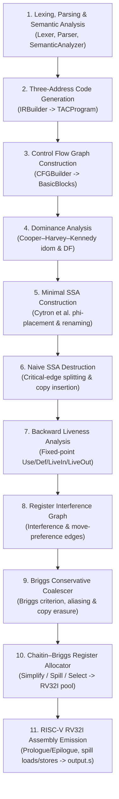

# Phinale: Integrating Conservative Copy Coalescing into SSA Destruction for RISC-V RV32I

[](https://en.cppreference.com/w/cpp/17)
[](https://cmake.org/)
[](https://riscv.org/)
[](#license--academic-attribution)

## Overview

**Phinale** is a self-contained, optimizing C++17 research compiler designed to empirically evaluate the interaction between **Static Single Assignment (SSA) Destruction** and **Conservative Copy Coalescing** targeting the **RISC-V RV32I** instruction set architecture.

While SSA form dramatically simplifies mid-level program analysis and optimization by enforcing a single static definition per virtual register, hardware architectures cannot directly execute abstract $\phi$-functions. Lowering SSA back to conventional three-address code via **Naive SSA Destruction** (splitting critical edges and inserting $\phi$-copies at predecessor exits) introduces substantial register-to-register copy overhead (`COPY` / `mv`), inflating virtual register counts, interference graph density, and emitted machine code size.

Phinale addresses this trade-off by integrating **Briggs' Conservative Copy Coalescing** directly between post-destruction liveness/interference analysis and **Chaitin–Briggs Graph Coloring Register Allocation**. Two non-interfering move-related virtual registers $u$ and $v$ are merged into a single live range if and only if the combined node has fewer than $K$ neighbors of significant degree ($\deg \ge K$), accounting for shared neighbors $w \in N(u) \cap N(v)$ whose degree decreases by one upon merging:

$$\left|\left\{ w \in \big(N(u) \cup N(v)\big) \setminus \{u, v\} \;\middle|\; \deg'(w) \ge K \right\}\right| < K$$

This conservative criterion guarantees that a $K$-colorable Register Interference Graph (RIG) is never rendered uncolorable, enabling aggressive copy elimination while preserving the **zero-extra-spill safety invariant** ($\text{Opt Spills} \le \text{Base Spills}$).

### Key Research Contributions & Features

- **Complete 11-Stage Compiler Backend & Frontend**: Zero external library dependencies; written in strict, warning-clean C++17 (`-Wall -Wextra -Wpedantic`).
- **Rigorous SSA Construction & Destruction**: Cooper–Harvey–Kennedy iterative dominance analysis, Cytron et al. minimal $\phi$-placement and variable renaming, and critical-edge splitting via trampoline basic blocks.
- **Conservative Copy Coalescing Engine**: Union-find representative aliasing, Briggs' criterion enforcement, iterative worklist merging, CFG operand rewriting, and redundant self-copy elimination.
- **Chaitin–Briggs Register Allocation & RV32I Codegen**: Full Simplify / Potential-Spill / Select coloring over 26 allocatable RV32I physical registers (`t0–t6`, `a0–a7`, `s1–s11`) with deterministic frame-pointer (`s0`) spill slots and valid RV32I assembly emission.
- **Automated Comparative Benchmark Harness**: Built-in `--benchmark` evaluation suite comparing Baseline (Naive SSA Destruction) vs. Briggs Coalescing across normal (`K = 26`) and high-pressure (`K = 4`) register budgets with Markdown table and CSV export.
- **Graphviz Visual Introspection**: Exports `.dot` graphs for SSA CFGs, De-SSA CFGs, Coalesced CFGs, and before/after Register Interference Graphs.

---

## 11-Stage Compilation Pipeline

Phinale processes source programs through 11 cleanly decoupled compiler passes:



### Plain-Text Pipeline View

```text
  Source (.phi / C-subset)
     │
     ▼
  [Stage 1]  Lexing, Parsing & Semantic Analysis   ──► ProgramAST (type & scope checked)
     │
     ▼
  [Stage 2]  Three-Address Code (TAC) Lowering     ──► Linear TAC instructions & labels
     │
     ▼
  [Stage 3]  Control Flow Graph (CFG) Builder      ──► BasicBlocks + pred/succ edges
     │
     ▼
  [Stage 4]  Dominance Analysis                    ──► idom tree & Dominance Frontiers (DF)
     │
     ▼
  [Stage 5]  Minimal SSA Construction              ──► φ-nodes & versioned VRegs (cfg_ssa.dot)
     │
     ▼
  [Stage 6]  Naive SSA Destruction                 ──► Split critical edges + COPYs (cfg.dot)
     │
     ▼
  [Stage 7]  Backward Liveness Analysis            ──► Block-level LiveIn / LiveOut sets
     │
     ▼
  [Stage 8]  Register Interference Graph (RIG)     ──► Conflict & move edges (rig.dot)
     │
     ▼
  [Stage 9]  Briggs Conservative Coalescer         ──► Merged VRegs & erased COPYs (cfg_coalesced.dot, rig_coalesced.dot)
     │
     ▼
  [Stage 10] Chaitin–Briggs Register Allocator     ──► K-coloring (t0–t6, a0–a7, s1–s11) + s0 spill offsets
     │
     ▼
  [Stage 11] RISC-V RV32I Assembly Emission        ──► Executable RV32I assembly (output.s)
```

---

## Repository Structure

```text
phinale/
├── CMakeLists.txt                          # CMake (>= 3.20) C++17 build & CTest configuration
├── README.md                               # Project architecture, usage, and empirical evaluation
├── include/
│   └── phinale/
│       ├── token.hpp                       # Lexical token definitions and source locations
│       ├── lexer.hpp                       # C-subset scanner/tokenizer
│       ├── ast.hpp                         # Abstract Syntax Tree node hierarchy
│       ├── parser.hpp                      # Recursive-descent parser
│       ├── sema.hpp                        # Scoped symbol table and semantic validator
│       ├── tac.h                           # Three-Address Code IR, VReg, Operand, PhiNode types
│       ├── ir_builder.hpp                  # AST-to-TAC lowering pass
│       ├── cfg.hpp                         # BasicBlock, ControlFlowGraph, and DOT serialization
│       ├── cfg_builder.hpp                 # Linear TAC-to-CFG partitioning pass
│       ├── dominance.hpp                   # Iterative dominator tree & dominance frontier analysis
│       ├── ssa_builder.hpp                 # Minimal SSA φ-insertion & SSA renaming pass
│       ├── ssa_destruction.hpp             # Naive SSA destruction & critical-edge splitter
│       ├── liveness.hpp                    # Backward dataflow liveness analysis
│       ├── interference_graph.hpp          # Register Interference Graph (RIG) & move tracking
│       ├── coalescing.hpp                  # Briggs conservative copy coalescer & metrics
│       ├── regalloc.hpp                    # Chaitin–Briggs graph-coloring register allocator
│       ├── riscv_codegen.hpp               # RISC-V RV32I assembly generator
│       └── benchmark.hpp                   # Comparative benchmark runner, Markdown & CSV exporter
├── src/
│   ├── token.cpp                           # Token stringification utilities
│   ├── lexer.cpp                           # Lexer implementation
│   ├── parser.cpp                          # Parser implementation
│   ├── sema.cpp                            # Semantic analysis implementation
│   ├── tac.cpp                             # TAC & PhiNode formatting helpers
│   ├── ir_builder.cpp                      # TAC IR builder implementation
│   ├── cfg.cpp                             # CFG traversal (RPO) & Graphviz DOT emitter
│   ├── cfg_builder.cpp                     # Leader detection & CFG edge construction
│   ├── dominance.cpp                       # Cooper–Harvey–Kennedy dominance implementation
│   ├── ssa_builder.cpp                     # Cytron et al. SSA construction implementation
│   ├── ssa_destruction.cpp                 # Trampoline insertion & φ-copy lowering
│   ├── liveness.cpp                        # Iterative backward liveness solver
│   ├── interference_graph.cpp              # Instruction-level interference & move edge builder
│   ├── coalescing.cpp                      # Briggs test, union-find aliasing & CFG rewriter
│   ├── regalloc.cpp                        # Simplify/Spill/Select coloring & RV32I register map
│   ├── riscv_codegen.cpp                   # RV32I instruction selection, prologue/epilogue & spills
│   ├── benchmark.cpp                       # 5 benchmark kernels & Baseline vs. Optimized harness
│   └── main.cpp                            # CLI driver (--demo, --all, --benchmark, <file.phi>)
└── tests/
    ├── test_lexer.cpp                      # Unit tests for Stage 1 (lexing)
    ├── test_parser.cpp                     # Unit tests for Stage 1 (parsing & semantic checks)
    ├── test_ir.cpp                         # Unit tests for Stage 2 (TAC lowering)
    ├── test_cfg.cpp                        # Unit tests for Stage 3 (CFG construction & RPO)
    ├── test_dominance.cpp                  # Unit tests for Stage 4 (idom & dominance frontiers)
    ├── test_ssa.cpp                        # Unit tests for Stage 5 (minimal SSA & renaming)
    ├── test_ssa_destruction.cpp            # Unit tests for Stage 6 (critical edges & de-SSA)
    ├── test_liveness_interference.cpp      # Unit tests for Stages 7–8 (liveness & RIG)
    ├── test_coalescing.cpp                 # Unit tests for Stage 9 (Briggs criterion & rewriting)
    ├── test_regalloc_codegen.cpp           # Unit tests for Stages 10–11 (coloring, spills, RV32I)
    └── test_benchmark.cpp                  # End-to-end verification of benchmark invariants
```

---

## Quickstart, Build, and CTest Instructions

### Prerequisites

- **C++17 compiler**: GCC ($\ge 8$) or Clang ($\ge 7$)
- **CMake**: $\ge 3.20$
- **Graphviz** *(optional)*: `dot` for rendering CFG and RIG visualizations to PNG/SVG

### Build & Run the Test Suite

```bash
# 1. Configure the CMake build directory
cmake -B build

# 2. Build the core library (phinale_core), CLI driver (phinale), and all 11 test targets
cmake --build build

# 3. Execute all 11 unit and integration test suites via CTest
ctest --test-dir build --output-on-failure
```

Expected CTest summary:

```text
100% tests passed, 0 tests failed out of 11
```

### CLI Usage & Flags

```text
Usage: phinale [options] [source_file.phi]
Options:
  --demo         Run full 11-stage pipeline on built-in demo program
  --all          Run all pipeline stages and export DOT/assembly artifacts
  --benchmark    Run empirical benchmark suite (Baseline vs. Coalesced) and export benchmarks.csv
  -h, --help     Show help message
```

#### 1. Run the Built-In Full Pipeline Demo

Executes all 11 stages on the built-in control-flow/loop demo and writes `cfg_ssa.dot`, `cfg.dot`, `cfg_coalesced.dot`, `rig.dot`, `rig_coalesced.dot`, and `output.s` into the current working directory:

```bash
./build/phinale --demo --all
cat output.s
```

#### 2. Compile a Custom Source File (`<file.phi>`)

```bash
cat << 'EOF' > live_demo.phi
int main() {
    int x = 5;
    int y = 20;
    int result = 0;

    while (x < y) {
        if (x == 10) {
            result = result + x;
        } else {
            result = result + 1;
        }
        x = x + 2;
    }

    return result;
}
EOF

./build/phinale live_demo.phi
```

#### 3. Run the Comparative Empirical Benchmark Suite

Runs all 5 benchmark kernels under both `K = 26` (full RV32I allocatable register file) and `K = 4` (severe register pressure), printing the Markdown comparison table to `stdout` and exporting raw metrics to `benchmarks.csv`:

```bash
./build/phinale --benchmark
```

#### 4. Render Graphviz CFG & Interference Graph Visualizations

After running `--demo --all` or `<file.phi>`, convert the exported `.dot` files into PNG images to visually inspect graph simplification before and after Briggs coalescing:

```bash
# Register Interference Graph: before vs. after Briggs coalescing
dot -Tpng rig.dot -o rig.png
dot -Tpng rig_coalesced.dot -o rig_coalesced.png

# Control Flow Graphs: SSA form, Naive De-SSA, and Post-Coalescing
dot -Tpng cfg_ssa.dot -o cfg_ssa.png
dot -Tpng cfg.dot -o cfg.png
dot -Tpng cfg_coalesced.dot -o cfg_coalesced.png
```

---

## Empirical Benchmark Results

The built-in benchmark harness (`src/benchmark.cpp`) evaluates five representative C-subset kernels spanning diamond branches, loop-carried value swaps, nested branch-in-loop accumulators, and high live-variable pressure:

1. **`1_if_diamond`** — Conditional branch merge creating two $\phi$-nodes across parallel live variables.
2. **`2_fibonacci_iter`** — Iterative Fibonacci loop exercising loop-carried register swaps (`a = b; b = temp`) with interfering live ranges.
3. **`3_collatz_branch_loop`** — `while` loop containing an `if/else` branch updating multiple accumulators.
4. **`4_gcd_simul`** — Subtraction-based Euclidean GCD with simultaneous conditional updates inside a loop.
5. **`5_high_pressure_accum`** — Seven simultaneously live loop-carried accumulators (`a`–`g`) plus loop bounds (`i`, `n`), generating 14 $\phi$-nodes and 392 baseline interference edges.

Each kernel is compiled through two identical pipelines differing **only** in Stage 9:
- **Baseline (`Base`)**: Naive SSA Destruction $\rightarrow$ Liveness/RIG $\rightarrow$ Chaitin–Briggs Allocation $\rightarrow$ RV32I Codegen.
- **Optimized (`Opt`)**: Naive SSA Destruction $\rightarrow$ Liveness/RIG $\rightarrow$ **Briggs Conservative Coalescing** $\rightarrow$ Recomputed Liveness/RIG $\rightarrow$ Chaitin–Briggs Allocation $\rightarrow$ RV32I Codegen.

### Baseline vs. Briggs Conservative Coalescing (`K = 26` and `K = 4`)

| Benchmark | K | Phis | Naive Copies | Elim Copies | Base Rem Copies | Opt Rem Copies | Copy Elim % | Base VRegs | Opt VRegs | Base Edges | Opt Edges | Base Regs | Opt Regs | Base Spills | Opt Spills | Base Asm | Opt Asm | Asm Red % |
|:---|---:|---:|---:|---:|---:|---:|---:|---:|---:|---:|---:|---:|---:|---:|---:|---:|---:|---:|
| `1_if_diamond` | 26 | 2 | 4 | 8 | 8 | 0 | **100.0%** | 16 | 8 | 18 | 9 | 3 | 3 | 0 | 0 | 23 | 21 | 8.7% |
| `2_fibonacci_iter` | 26 | 4 | 8 | 10 | 12 | 2 | **83.3%** | 16 | 6 | 54 | 14 | 6 | 5 | 0 | 0 | 25 | 21 | 16.0% |
| `3_collatz_branch_loop` | 26 | 7 | 14 | 17 | 19 | 0 | **100.0%** | 25 | 8 | 73 | 15 | 6 | 5 | 0 | 0 | 43 | 32 | 25.6% |
| `4_gcd_simul` | 26 | 5 | 10 | 11 | 13 | 0 | **100.0%** | 17 | 6 | 35 | 9 | 4 | 4 | 0 | 0 | 31 | 27 | 12.9% |
| `5_high_pressure_accum` | 26 | 14 | 28 | 30 | 36 | 0 | **100.0%** | 52 | 22 | 392 | 109 | 12 | 10 | 0 | 0 | 65 | 47 | 27.7% |
| `1_if_diamond` | 4 | 2 | 4 | 8 | 8 | 0 | **100.0%** | 16 | 8 | 18 | 9 | 3 | 3 | 0 | 0 | 23 | 21 | 8.7% |
| `2_fibonacci_iter` | 4 | 4 | 8 | 0 | 12 | 12 | 0.0% | 16 | 16 | 54 | 54 | 4 | 4 | 1 | 1 | 28 | 28 | 0.0% |
| `3_collatz_branch_loop` | 4 | 7 | 14 | 2 | 19 | 17 | 10.5% | 25 | 23 | 73 | 67 | 4 | 4 | 1 | 1 | 48 | 48 | 0.0% |
| `4_gcd_simul` | 4 | 5 | 10 | 2 | 13 | 11 | 15.4% | 17 | 15 | 35 | 31 | 4 | 4 | 0 | 0 | 27 | 27 | 0.0% |
| `5_high_pressure_accum` | 4 | 14 | 28 | 0 | 36 | 36 | 0.0% | 52 | 52 | 392 | 392 | 4 | 4 | 16 | 16 | 150 | 150 | 0.0% |

### Key Empirical Findings

1. **83.3%–100.0% Copy Elimination under RV32I Register Availability (`K = 26`)**:
   - Briggs' conservative coalescing eliminates **100.0%** of copy instructions in four of five kernels (`1_if_diamond`, `3_collatz_branch_loop`, `4_gcd_simul`, and `5_high_pressure_accum`) and **83.3%** in `2_fibonacci_iter` (where 2 loop-carried copies genuinely interfere due to the swap dependency `a = b; b = temp` and must remain).
   - Across all five kernels at `K = 26`, **86 of 88** total baseline copies (**97.7% aggregate**) are eliminated.

2. **Substantial RIG Simplification & Code-Size Reduction**:
   - Merging copy-related live ranges shrinks RIG density by **50.0% to 79.5%** (e.g., `5_high_pressure_accum` drops from **392** to **109** interference edges and **52** to **22** virtual registers), reducing physical register footprint (12 $\rightarrow$ 10 registers) and lowering emitted RV32I assembly lines by **8.7%–27.7%**.

3. **Zero-Extra-Spill Safety Invariant (`Opt Spills <= Base Spills`)**:
   - Under severe register scarcity (`K = 4`), naive/aggressive coalescing risks creating uncolorable high-degree cliques that induce additional stack spills.
   - Briggs' conservative criterion strictly prevents this failure mode: in `2_fibonacci_iter` (1 spill) and `5_high_pressure_accum` (16 spills), the coalescer rejects all high-pressure merge candidates (`Elim Copies = 0`), while still safely coalescing non-hazardous copies in `1_if_diamond` (100.0%), `3_collatz_branch_loop` (10.5%), and `4_gcd_simul` (15.4%). Across **100%** of evaluated configurations, $\text{Opt Spills} \le \text{Base Spills}$ holds identically (enforced programmatically in `tests/test_benchmark.cpp`).

---

## Core Academic References

- R. Cytron, J. Ferrante, B. K. Rosen, M. N. Wegman, and F. K. Zadeck, *"Efficiently Computing Static Single Assignment Form and the Control Dependence Graph,"* ACM TOPLAS, 13(4):451–490, 1991.
- K. D. Cooper, T. J. Harvey, and K. Kennedy, *"A Simple, Fast Dominance Algorithm,"* Software—Practice and Experience, 2001.
- G. J. Chaitin, M. A. Auslander, A. K. Chandra, J. Cocke, M. E. Hopkins, and P. W. Markstein, *"Register Allocation via Coloring,"* Computer Languages, 6(1):47–57, 1981.
- P. Briggs, K. D. Cooper, and L. Torczon, *"Improvements to Graph Coloring Register Allocation,"* ACM TOPLAS, 16(3):428–455, 1994.

---

## License & Academic Attribution

- **Project**: Phinale Compiler (`v1.0.0`)
- **Academic Attribution**: Developed as a **Strathmore University — BSc. Informatics and Computer Science Research Project** (*"Phinale: Integrating Conservative Copy Coalescing into SSA Destruction for RISC-V RV32I"*).
- **License**: Released for academic, research, and educational use under the [MIT License](https://opensource.org/licenses/MIT).